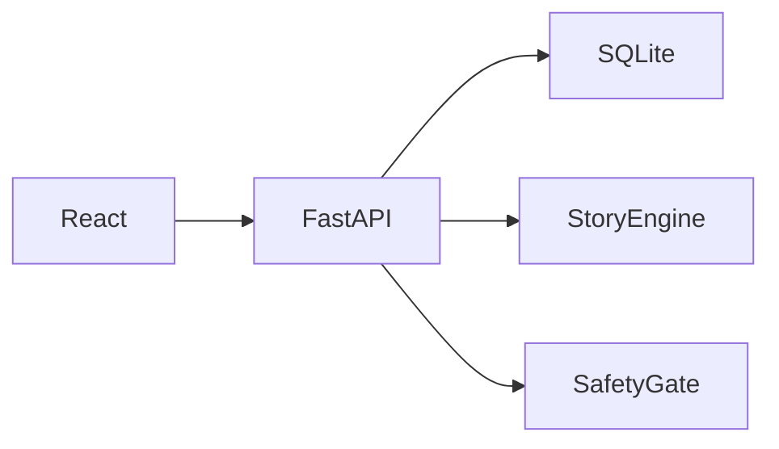

# Dear Alex

> Coach a fictional friend through a hard moment, then discover the advice was for you.

Dear Alex is a private, playful self-help experience for university students after a setback. It turns self-distancing into a four-minute narrative: the user helps Alex, then watches the story return to their own words as a Letter to You.

## The problem

After a disappointing grade, awkward interaction, or failed performance, students often meet themselves with a harsher voice than they would use with a friend. Dear Alex creates a little distance first, so the player can practise a fairer response.

## The idea and research basis

The player tells Alex’s story, offers three pieces of coaching, and receives their own advice as a saved letter. The mechanism is self-distancing, not points: viewing a situation from an outside perspective can support wiser reasoning and emotion regulation [1]–[3].

## Features

- Optional 1–5 mood check-in and always-visible skip/exit paths.
- Intake, category selection, and character naming.
- Deterministic, aligned first-person-to-third-person story transformation with a safe fallback.
- Crisis-language safety route that does not retain flagged text.
- Three coaching scenes with Compassion, Perspective, and Action cards or free text.
- A responsive CSS “Alex’s World,” plus reduced-motion support.
- A skippable reveal and Letter to You.
- Local SQLite vault and pressure-free collection.
- Scored past-letter resurfacing, JSON export, and device-scoped deletion.
- Demo seed data: `python -m app.seed_demo`.

## What we deliberately did not build

No streaks, streak restores, XP loss, push notifications, leaderboards, accounts, paywalls, or social sharing. A wellbeing tool should not turn missed days into guilt.

## Quick start

Prerequisites: Python 3.11+ and Node.js 20+.

```bash
git clone https://github.com/buzludeniz/dear-alex.git
cd dear-alex/backend
python -m venv .venv
# Windows PowerShell: .\.venv\Scripts\Activate.ps1
pip install -r requirements.txt
uvicorn app.main:app --reload
```

In another terminal:

```bash
cd dear-alex/frontend
npm install
npm run dev
```

Open `http://localhost:5173`. To add labelled demo data, run from `backend`: `python -m app.seed_demo`. Its terminal output prints the demo device ID; set that ID in browser localStorage under `dear-alex-device-id` to view it.

## Two-minute demo

1. Skip check-in or choose mood 2.
2. Enter a mild academic worry and meet Alex.
3. Choose one card in every coaching scene.
4. Show the Reveal and Letter to You.
5. Open Letter vault, then choose “Open a letter from past you.”

## Architecture



See [the full architecture document](docs/ARCHITECTURE.md).

## Safety and privacy

This is not therapy or a substitute for professional care. A conservative safety check routes clear crisis wording to 9-8-8 (Canada) and UVic Counselling information; it is intentionally evaluated before text reaches the database. There are no accounts or analytics. Data stays on the local deployment and can be exported or deleted.

## Testing

```bash
cd backend
pytest
ruff check .
black --check .
```

Tests cover 30+ story-engine examples, crisis detection and false-positive guards, and deterministic resurfacing selection.

## Project structure

```text
backend/app/       FastAPI, models, story engine, safety, seed script
backend/tests/     pytest suite
frontend/src/      React screens and interaction styles
docs/              architecture, design principles, AI disclosure, media
```

## Limitations and next steps

The rule-based language transform only supports common English first-person forms and uses a quoted fallback for uncertain text. The crisis check is not a clinical assessment. Future work could include expanded linguistic rules, locally stored accessibility preferences, and user research with appropriate ethics review.

## AI usage

See [AI usage disclosure](docs/AI_USAGE.md).

## License

MIT © 2026 Deniz Ikili. See [LICENSE](LICENSE).

## References

1. E. Kross et al., “Self-talk as a regulatory mechanism: How you do it matters,” *Journal of Personality and Social Psychology*, 2014.
2. I. Grossmann and E. Kross, “Exploring Solomon’s paradox,” *Psychological Science*, 2014.
3. E. Kross and O. Ayduk, “Self-distancing: Theory, research, and current directions,” *Advances in Experimental Social Psychology*, 2017.
