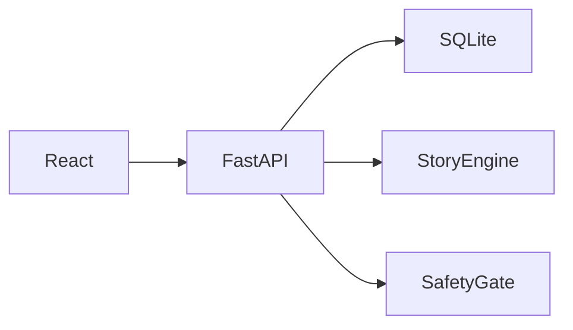

# Dear Alex

> Coach a fictional friend through a hard moment, then discover the advice was for you.

Dear Alex is a private, playful self-help experience for university students after a setback. It turns self-distancing into a four-minute narrative: the user helps Alex, then watches the story return to their own words as a Letter to You.

## The problem

After a disappointing grade, awkward interaction, or failed performance, students often meet themselves with a harsher voice than they would use with a friend. Dear Alex creates a little distance first, so the player can practise a fairer response.

## The idea and research basis

The player tells Alex’s story, offers three pieces of coaching, and receives their own advice as a saved letter. The mechanism is self-distancing, not points: viewing a situation from an outside perspective can support wiser reasoning and emotion regulation [1]–[3].

Read [the full research basis document](docs/RESEARCH.md) for in-depth analysis of Solomon's Paradox and how each study maps directly to our design choices.

## Features

- **Optional 1–5 mood check-in** with always-visible skip/exit paths.
- **Intake, category selection, and character naming** (personalize your companion).
- **Deterministic, aligned first-person-to-third-person story engine** with confidence scoring and safe fallback.
- **Crisis-language safety gate** that routes to Canadian 9-8-8 and UVic Counselling before saving to database.
- **Three coaching scenes** with 18 curated Compassion, Perspective, and Action cards or free text.
- **Dynamic visual world ("Alex’s World")**: sky, light level, and horizon brighten as kind advice is offered.
- **Word-by-word Reveal animation**: tokens morph back into your own original sentences.
- **Classical ambient music**: local, opt-in Web Audio synthesis playing Bach's C Major Prelude (BWV 846) arpeggios (zero network calls).
- **Light & Dark mode**: seamless theme switching respecting accessibility and contrast.
- **Automated showcase procedure**: click "Watch auto-demo" on the home screen or run our automated scripts.
- **Local SQLite vault & collection slots** that celebrate growth without streak pressure.
- **Scored past-letter resurfacing**, JSON export, and device-scoped deletion.
- **Demo seed data**: `python -m app.seed_demo`.

## What we deliberately did not build

No streaks, streak restores, XP loss, push notifications, leaderboards, accounts, paywalls, or social sharing. A wellbeing tool should not turn missed days into guilt.

## Quick start

Prerequisites: Python 3.11+ and Node.js 20+.

```bash
git clone https://github.com/buzludeniz/dear-alex.git
cd dear-alex/backend
python -m venv .venv
# Windows PowerShell: .\.venv\Scripts\Activate.ps1
pip install -r requirements.txt
uvicorn app.main:app --reload
```

In another terminal:

```bash
cd dear-alex/frontend
npm install
npm run dev
```

Open `http://localhost:5173`. To add labelled demo data, run from `backend`: `python -m app.seed_demo`. Its terminal output prints the demo device ID; set that ID in browser localStorage under `dear-alex-device-id` to view it.

## Automated showcase & test suite

You can run automated end-to-end verification and interactive showcases in four ways:

1. **Unified Master Test & Concurrency Suite (Recommended)**:
   ```bash
   python scripts/automated_system_test.py
   ```
   Automatically kickstarts servers and executes:
   - **Stage 1**: Multi-threaded database concurrency stress test (measures throughput, p50/p95 latency, zero DB locks).
   - **Stage 2**: Launches Chrome and drives a complete normal student session (mood, intake, 3 scenes, lantern glow, word-by-word reveal, letter vault).
   - **Stage 3**: Launches Chrome and tests an emergency crisis interaction (verifies immediate 9-8-8 helpline & UVic Counselling routing, plus direct cryptographic verification that zero crisis text was saved to SQLite).
   *(Add `--headless` to run Chrome without a visible window).*

2. **In-App Auto-Demo (Zero setup)**:
   Open `http://localhost:5173` and click **"Watch auto-demo"** on the welcome screen. The app will automatically enter a realistic student scenario, coach Alex, morph the words in the Reveal, and seal the letter.

3. **Terminal API Showcase Runner**:
   ```bash
   python scripts/api_showcase.py
   ```
   Simulates and validates the complete game loop, self-distancing transform, 3 scenes, and letter generation in your terminal.

4. **Standalone Browser Automation**:
   ```bash
   python scripts/demo.py --headed --slow
   ```

## Architecture



See [the full architecture document](docs/ARCHITECTURE.md).

## Safety and privacy

This is not therapy or a substitute for professional care. A conservative safety check routes clear crisis wording to 9-8-8 (Canada) and UVic Counselling information; it is intentionally evaluated before text reaches the database. There are no accounts or analytics. Data stays on the local deployment and can be exported or deleted.

## Testing

```bash
cd backend
pytest
ruff check .
black --check .
```

Tests cover 60+ story-engine examples, crisis detection and false-positive guards, deterministic resurfacing selection, and complete end-to-end API workflows.

## Project structure

```text
backend/app/       FastAPI, models, story engine, safety, seed script
backend/tests/     pytest suite (61 tests covering engine, safety, resurfacing, showcase)
frontend/src/      React screens, Web Audio classical synthesizer, and styles
scripts/           Automated showcase scripts (in-browser Playwright & terminal runner)
docs/              Research basis, architecture, design principles, AI disclosure
```

## Limitations and next steps

The rule-based language transform only supports common English first-person forms and uses a quoted fallback for uncertain text. The crisis check is not a clinical assessment. Future work could include expanded linguistic rules, locally stored accessibility preferences, and user research with appropriate ethics review.

## AI usage

See [AI usage disclosure](docs/AI_USAGE.md).

## License

MIT © 2026 Deniz Ikili. See [LICENSE](LICENSE).

## References

1. E. Kross et al., “Self-talk as a regulatory mechanism: How you do it matters,” *Journal of Personality and Social Psychology*, 2014.
2. I. Grossmann and E. Kross, “Exploring Solomon’s paradox,” *Psychological Science*, 2014.
3. E. Kross and O. Ayduk, “Self-distancing: Theory, research, and current directions,” *Advances in Experimental Social Psychology*, 2017.
