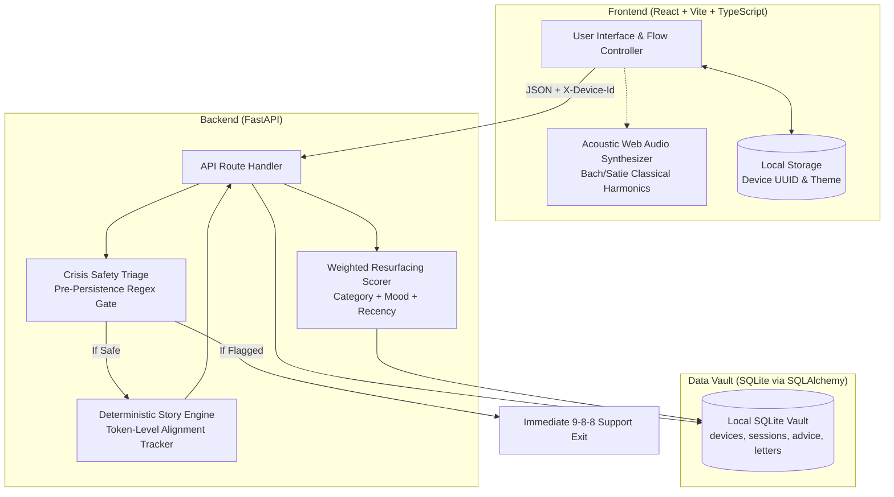
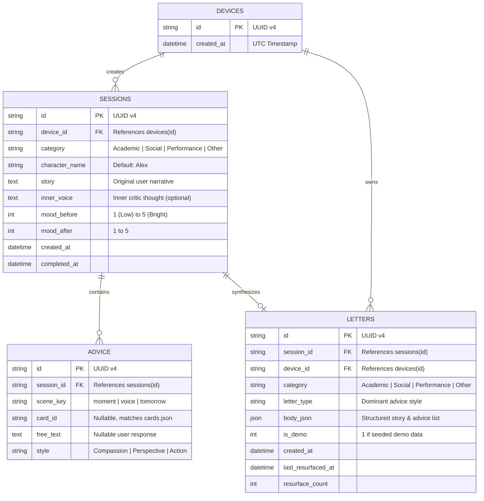

# Architecture & Technical Specification

Dear Alex is an offline-first, privacy-respecting gamified mental health web application built on **FastAPI (Python 3.11+)** and **React 18 + Vite (TypeScript)**.

---

## 1. Data Models & SQLite Schema

Four core relational tables configured via SQLAlchemy ORM:

---

## 2. API Contract & Endpoints

All endpoints use standard JSON contracts and require the anonymous client UUID via `X-Device-Id` header.

| Method | Endpoint | Description | Request Body | Response Payload |
|---|---|---|---|---|
| `GET` | `/` / `/health` / `/api/health` | Health probe & service status | None | `{"ok": true}` |
| `GET` | `/api/cards` | Retrieve all 18 coaching cards & reactions | None | `Card[]` |
| `POST` | `/api/story` | Safety check & 3rd-person story transform | `{story, character_name}` | `{"safe": bool, "tokens": Token[], "confidence": float, "fallback": bool}` |
| `POST` | `/api/sessions` | Begin a coaching session | `{story, inner_voice, category, character_name, mood_before}` | `{"safe": bool, "id": string}` |
| `POST` | `/api/sessions/{id}/advice` | Record one card or free-text advice | `{scene_key, card_id, free_text, style}` | `{"safe": bool}` |
| `POST` | `/api/sessions/{id}/finish` | Synthesize advice into a Letter & Reveal | `{mood_after}` | `{"letter": Letter, "reveal": Token[]}` |
| `GET` | `/api/vault` | Retrieve saved letters and category counts | None | `{"letters": Letter[], "collection": Record<string, int>}` |
| `GET` | `/api/vault/surprise` | Scored weighted resurfacing of past letters | Query: `?category=&mood=` | `{"letter": Letter \| null}` |
| `GET` | `/api/vault/export` | Export device records as downloadable JSON | None | JSON file download |
| `DELETE` | `/api/vault` | Device-scoped deletion of all sessions & letters | None | HTTP 204 No Content |

---

## 3. Core Engine Subsystems

### A. Token-Level Aligned Story Engine (`app/story_engine.py`)
- Regex-based tokenizer preserves punctuation, whitespace, and capitalization.
- Maps 1st-person pronouns (`I`, `me`, `my`, `mine`, `myself`, contractions `I'm`, `I've`, `I'll`, `I'd`) and common present verbs (`am`, `have`, `do`, `feel`, `think`, etc.) to 3rd-person equivalents.
- Tracks `(orig, alex, changed)` for every token, enabling the frontend's word-by-word Reveal animation.
- Includes a confidence score: if 0 words can be reliably transformed, falls back to an explicit quoted template (`"{name} is going through this: “...”"`) to prevent ungrammatical guesses.

### B. Pre-Persistence Safety Gate (`app/safety.py`)
- Scans user free text with 15 compiled regex crisis patterns.
- Evaluates 10 false-positive guards (e.g., *"die my hair"*, *"joke was suicidal"*, *"overdose of homework"*).
- **Hard Privacy Rule**: Flagged text is returned to the user with 9-8-8 hotline guidance and **never** saved to SQLite or disk logs.

### C. Scored Resurfacing Algorithm (`app/resurface.py`)
Computes an affinity score for each vault letter when a user requests "Open a letter from past you":
$$\text{Score} = \text{Bonus}_{\text{category}} (+3) + \text{Bonus}_{\text{low\_mood\_compassion}} (+2) - \text{Penalty}_{\text{shown\_within\_7\_days}} (5) + \epsilon_{\text{jitter}}$$
Selects stochastically among the top 3 ranked letters using positive weight normalization, ensuring high relevance while avoiding repetitive predictability.

### D. Acoustic Web Audio Synthesizer (`frontend/src/lib/useAmbient.ts`)
- Synthesizes classical acoustic piano voicings using additive multi-harmonic sines, hammer strike transients, and a simulated 2.8-second concert hall convolver reverb.
- Plays an Erik Satie / J.S. Bach inspired contemplative nocturne progression in G/C.
- Completely local and offline (0 external assets, 0 network requests).
