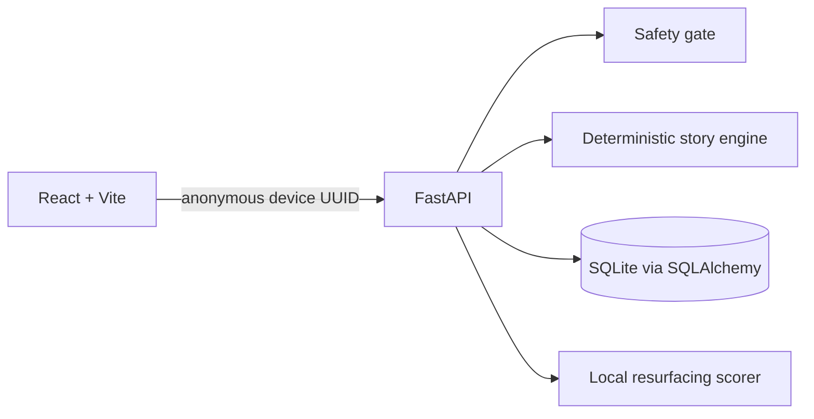

# Architecture

## Data and API

SQLite holds `devices`, `sessions`, `advice`, and `letters`. The browser owns a random device UUID in localStorage; no account or third-party service is involved.

| Endpoint | Purpose |
|---|---|
| `POST /api/story` | Safety check and aligned Alex-story tokens |
| `POST /api/sessions` | Start a safe session |
| `POST /api/sessions/{id}/advice` | Persist one coaching answer |
| `POST /api/sessions/{id}/finish` | Create the Letter to You |
| `GET /api/vault` | Vault and collection slots |
| `GET /api/vault/surprise` | Local scored resurfacing |
| `GET /api/vault/export` | JSON export |
| `DELETE /api/vault` | Delete device-scoped data |

The engine is rule-based, preserving each original token beside its Alex equivalent. Unknown phrasing uses a quoted fallback rather than making an unsafe grammatical guess. Resurfacing favors category alignment and Compassion letters after low moods, avoids letters shown in the last seven days, then uses seeded-testable weighted randomness among the top three.
