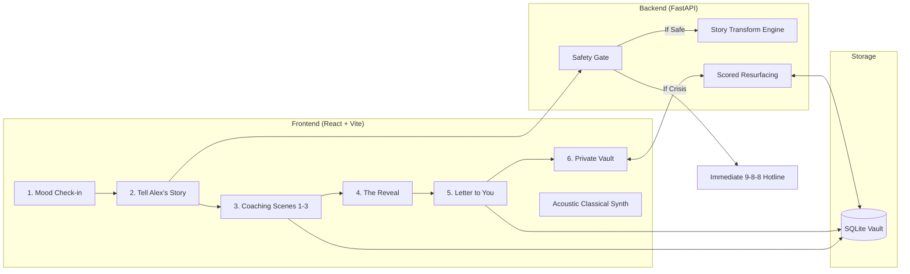

# Dear Alex — Complete Documentation & Starter Guide

> **Welcome to Dear Alex.** This guide helps developers quickly understand the project, explore psychological mechanics, and kickstart every part of the application in seconds.

---

## 1. What is Dear Alex?

### The Core Problem
University students often meet setbacks—a bombed exam, awkward social interaction, or imposter syndrome—with a harsh, punitive inner critic. Standard mental health tools (gratitude journals, mood tracking sliders) ask students to stare directly at themselves, precisely where the negative voice is loudest.

### The Solution: Self-Distancing & Solomon's Paradox
Extensive psychological research by Ethan Kross and Igor Grossmann demonstrates **Solomon’s Paradox**: people reason with substantially greater wisdom, nuance, and compassion about *other people’s* problems than their own.

**Dear Alex** turns this cognitive mechanism into an intuitive 4-minute interactive experience:
1. **Intake**: Describe a real setback, framing it as a story about a fictional friend named **Alex**.
2. **Coaching**: Guide Alex through three grounded scenes (*The Moment*, *The Voice*, *Tomorrow*) choosing or writing compassionate advice. As advice is offered, Alex's campsite lantern and horizon brighten.
3. **The Reveal**: The screen pauses with the words: *"That advice was for you."* The narrative animates token-by-token from Alex's story back into original user sentences.
4. **Letter to You**: The advice given to Alex is synthesized and sealed into a private vault, available to resurface when needed.

---

## 2. Instant 60-Second Kickstart

Three fast ways to see the entire system working:

### Option A: In-App Diagnostics & Live Test Launcher
1. Start the servers (see Section 3 below).
2. Open `http://localhost:5173` in a browser.
3. Click **"Diagnostics & Tests"** on the hero screen or top utility bar.
4. Run live tests for backend health, normal workflow simulation, and emergency crisis redirection directly inside the browser.

### Option B: The One-Command Automated Suite
Run the unified automation script. It automatically kickstarts both servers, runs a database concurrency stress test, and launches Chrome to drive normal and emergency interactions:
```bash
python scripts/automated_system_test.py
```
*(Add `--headless` to run Chrome without a visible window).*

### Option C: The Zero-Setup In-App Auto-Demo
1. Start the servers (see Section 3 below).
2. Open `http://localhost:5173` in a browser.
3. Click **"Watch auto-demo"** on the welcome screen.
4. Sit back and watch the application automatically enter a realistic academic setback, coach Alex, observe the lantern glowing, and execute the Reveal.

---

## 3. Manual Step-by-Step Developer Kickstart

### Prerequisites
- **Python**: 3.11+
- **Node.js**: 20+ (with npm)
- **OS**: Windows, macOS, or Linux

### Step 1: Start the Backend (FastAPI)
Open a terminal in the project root:

```bash
cd backend

# Create virtual environment
python -m venv .venv

# Activate virtual environment
# Windows PowerShell:
.\.venv\Scripts\Activate.ps1
# macOS/Linux:
source .venv/bin/activate

# Install dependencies
pip install -r requirements.txt

# Start FastAPI server with live reload
uvicorn app.main:app --reload --port 8000
```
- The backend starts at `http://127.0.0.1:8000`.
- Verify by visiting: `http://127.0.0.1:8000/health` (returns `{"ok": true}`).
- View interactive Swagger documentation: `http://127.0.0.1:8000/docs`.

### Step 2: Start the Frontend (React + Vite)
Open a second terminal in the project root:

```bash
cd frontend

# Install npm packages
npm install

# Start Vite dev server
npm run dev
```
- Open browser to `http://localhost:5173`.

### Step 3: Seed Demo Letters (Optional)
To pre-populate the vault with labelled past letters for demonstration:

```bash
cd backend
python -m app.seed_demo
```
*The command outputs a demo device UUID (e.g. `00000000-0000-0000-0000-000000000001`). Set this value in browser Developer Tools under `localStorage["dear-alex-device-id"]` to immediately explore a populated vault.*

---

## 4. How the App Works: Flow & Architecture



### The Game Loop Breakdown
1. **Mood Check-in**: Optional 1–5 scale ("Low", "Tender", "Okay", "Steady", "Bright"). Always skippable with zero guilt.
2. **Intake**: Two prompts: (a) *What happened?* (b) *What is the harshest thing your inner critic is saying?* Category chips: *Academic*, *Social*, *Performance*, *Other*. Character rename: default is *Alex*.
3. **Story Engine**: Pure Python regex transformation converts (a) into third person (*"I failed"* -> *"Alex failed"*). The inner critic is preserved in quotes as Alex's inner voice.
4. **Three Coaching Scenes**:
   - *Scene 1: The Moment* (What does Alex need right now?)
   - *Scene 2: The Voice* (How would you answer Alex's inner critic?)
   - *Scene 3: Tomorrow* (What is one tiny thing Alex can do next?)
   - Each scene offers 6 cards tagged by style (**Compassion**, **Perspective**, **Action**) plus free-text input.
5. **Alex's Visual World**: High-fidelity illustrated character sitting on a hillside. As advice is given, the horizon warms and Alex's campsite lantern brightens.
6. **The Reveal**: Words animate token-by-token from Alex's perspective back to original user sentences: *"That advice was for you."*
7. **Letter to You & Vault**: Full letter stored under an anonymous device UUID in SQLite.
8. **Surprise Resurfacing**: Scored algorithm (+3 category match, +2 low mood compassion, -5 recency penalty) resurfaces wisdom from past reflections when needed.

---

## 5. Testing & Quality Assurance Suite

Dear Alex comes with an extensive testing suite:

### 1. Pytest Unit, Integration & Edge-Case Tests (76 Tests)
Run from the `backend/` directory:
```bash
.venv/bin/pytest -v
```
- `tests/test_story_engine.py`: Pronouns, irregular verbs, contractions, capitalization, custom names, and fallback templates.
- `tests/test_safety.py`: Crisis phrases, false-positive guards (*"die my hair"*), and multi-field inputs.
- `tests/test_resurface.py`: Determinism of weighted letter selection and empty vault handling.
- `tests/test_api_showcase.py`: Complete API workflow test through FastAPI's TestClient.
- `tests/test_edge_cases.py`: Multi-threaded database concurrency stress test, multi-field crisis checks, and resurfacing recency decay math.

### 2. Database Concurrency Stress Test
Run the concurrency suite to simulate simultaneous users executing full reflection sessions:
```bash
python scripts/automated_system_test.py --stress-only
```
- Confirms zero database locks under SQLite WAL mode with 175+ requests/sec throughput.

---

## 6. Key Ethical Design Choices ("The Anti-Features")

Unlike traditional engagement-driven apps, Dear Alex is built with strict psychological ethics:

- No Streaks or Penalties: Broken streaks cause guilt during periods of depression or academic burnout. In Dear Alex, letters never expire or decay.
- No Accounts or Third-Party Logins: No tracking, cookies, or cloud sync. All data is isolated to the local device.
- No Paid APIs or Runtime Telemetry: Zero external network requests at runtime; complete privacy.
- No Forced Traps: Every screen has an explicit, penalty-free **"Not today"** exit button.
- Pre-Persistence Crisis Gate: If crisis wording is entered, the session immediately halts and provides direct 9-8-8 phone/SMS links; the flagged text is **never** saved to disk.
